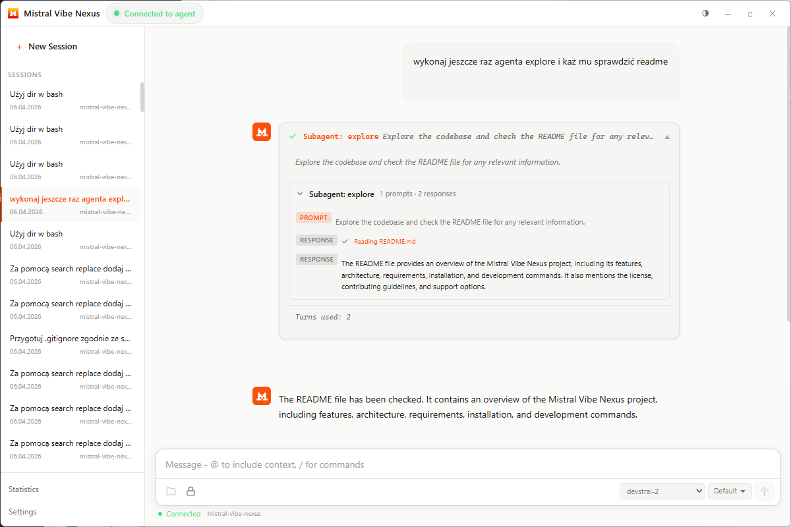

# Mistral Vibe Nexus

Electron desktop application wrapping the `vibe-acp` CLI (Mistral Vibe AI coding agent).



## Features

- Cross-platform desktop application
- Integration with Mistral Vibe AI coding agent
- Session management and statistics
- Multi-language support (English, Polish, French, Spanish, German, Italian)
- Automatic dependency setup

## Architecture

Three-process Electron application:
- **Main process**: Window creation, IPC handlers, ACP manager, config/vibe-stats loading
- **Preload script**: Typed IPC bridge exposed via `window.api`
- **Renderer process**: React UI (Vite)

## Requirements

- Node.js 16+
- npm or yarn
- Python 3.8+ (for vibe-acp)
- uv (Python package manager)

## Installation

```bash
# Clone the repository
git clone https://github.com/yourusername/mistral-vibe-nexus.git
cd mistral-vibe-nexus

# Install dependencies
npm install

# Install Python dependencies (automatically handled by setup flow)
# The app will guide you through this on first run
```

## Development

```bash
# Start development server
npm run dev

# Build for production
npm run build

# Create distributable packages
npm run dist

# Run type checking
npm run typecheck
```

## Build Commands

- `npm run dev`: Development mode with hot reloading
- `npm run build`: Build all processes (main, preload, renderer)
- `npm run dist`: Create distributable packages
- `npm run start`: Run built application

## Configuration

Application configuration is stored in Electron's `userData` path as `config.json`.

## Acknowledgments

Thanks to [@ahh1539 (Alex H)](https://github.com/ahh1539) for creating [Vibe Helper](https://github.com/ahh1539/vibe-helper) for macOS. The Statistics tab in Mistral Vibe Nexus was inspired by his application.

## Testing

Code is tested on Windows only. Builds for Linux and macOS are provided but not actively tested. If you encounter any issues on other platforms, please report them.

## License

This project is licensed under the Apache License 2.0 - see the [LICENSE](LICENSE) file for details.

## Contributing

Contributions are welcome! Please open an issue or submit a pull request.

## Support

For issues and feature requests, please use the GitHub issue tracker.

If you find this project helpful and would like to support its development:

[](https://buymeacoffee.com/dragonk93)
