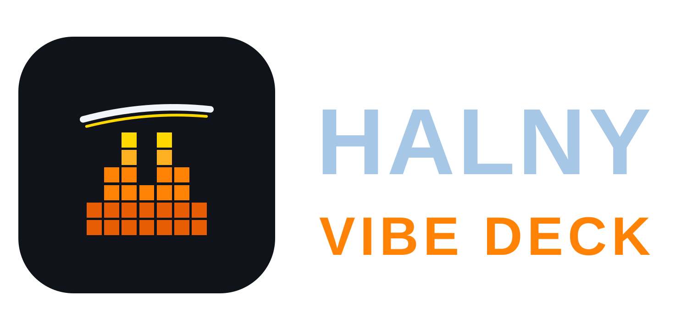

# Halny Vibe Deck

**A desktop and web client for the [Mistral Vibe](https://vibe.mistral.ai) AI coding agent** — built on Electron + React, talking to the `vibe-acp` CLI over ACP.



> **Unofficial project.** Halny Vibe Deck is built by an independent developer and is **not affiliated with, endorsed by, or supported by Mistral AI**. The author has no connection to Mistral — the project simply builds on top of Mistral Vibe and the Mistral Vibe CLI (`vibe-acp`). "Mistral" and "Mistral Vibe" are trademarks of Mistral AI.
>
> ✎ **Formerly known as Mistral Vibe Nexus** — the project and repository were renamed; old links redirect automatically.

**Why "Halny"?** The *halny* is the famous foehn wind that blows over the Polish Tatra mountains. Mistral is a wind too — a cold one from the Rhône valley. An unofficial client built by a Polish developer, for an agent named after a French wind, deserved a Polish wind of its own.

## Features

### Chat & agent workflow
- **Streaming conversations** with the agent: thinking, tool calls, colored diffs and file links
- **Per-session model and thinking level** — every session remembers its own configuration
- **Prompt queue** with send-now, retry, image attachments and `@file` mentions
- **Plans (todo checklists)** stay pinned in view while the agent works
- **Usage bar**: context %, cache hit ratio, tokens/s and live cost per session

### Sessions, history & statistics
- **Real session resume** with full history replay
- **History tab**: search by title or full message content, time filters
- **Statistics**: tokens (input/cached/output), cache hit ratio, cost per model and session

### Files, preview & editing
- **Dock panel**: file tree, git status and file preview tabs
- **Built-in editor (CodeMirror 6)** — click a file in chat or the tree, edit, hit Ctrl+S
- **Supported previews**: source/text, images, PDF (up to 20 pages), spreadsheets, Word docs, Markdown, Mermaid diagrams, zip archives, directories and colored git diffs

### Remote SSH projects
- Add any number of SSH remotes — sessions, file tree, git and file editing all run **on the remote host**
- Sessions on remotes resume just like local ones

### Serve — browser & mobile access
- Built-in **HTTPS server** with login & password
- **PWA**: install on your phone, dark UI, long-press menus
- Runs headless on a server — see the wiki

### Configuration
- Settings for **models, agents, MCP servers, skills, prompts and tools**
- **Global and per-project scopes**, raw TOML editor for the CLI config
- 6 languages: English, Polish, French, Spanish, German, Italian

## Quick start

### Windows
Download `Halny-Vibe-Deck-Setup-<version>.exe` (installer) or the portable zip from the [releases](https://github.com/Dragonk/halny-vibe-deck/releases) page.

### Linux
```bash
# User installation (no root), adds the 'halny' command
curl -fsSL https://raw.githubusercontent.com/Dragonk/halny-vibe-deck/main/scripts/install-linux.sh | bash

# or use the AppImage:
chmod +x halny-vibe-deck-<version>-x64.AppImage
./halny-vibe-deck-<version>-x64.AppImage
```

Headless server (systemd autostart, login & password): see the **wiki**.

### From source
```bash
git clone https://github.com/Dragonk/halny-vibe-deck.git
cd halny-vibe-deck
npm install
npm run build
npm start             # desktop
npx electron . --headless --serve --port=8443   # headless server
```

## Architecture
Three-process Electron application: **main** (window, IPC, ACP manager, SSH, HTTPS server), **preload** (`window.api`), **renderer** (React UI shared by desktop and web/PWA).

## Wiki
Detailed documentation lives in the **wiki**: Installation, Headless Server, File Preview, Sessions, Remote SSH, Settings, Development.

## Requirements
- Node.js 16+ and npm
- Python 3.8+ and `uv` — the app installs the `mistral-vibe` CLI on first run

## Development
```bash
npm run dev          # development mode
npm run build        # build main, preload, renderer
npm run typecheck    # typecheck all three tsconfigs
npm run dist         # distributable packages
```

## Testing
Tested primarily on Windows; Linux builds are provided and used for headless servers. Please report issues.

## Acknowledgments
@ah1539 (Alex H) for vibe-helper for macOS. The Statistics tab was inspired by his application.

## License
Apache License 2.0 — see the [LICENSE](LICENSE) file.

## Contributing & Support
Contributions are welcome — open an issue or a pull request. You can support development at [buy me a coffee](https://www.buymeacoffee.com/dragonk93).
