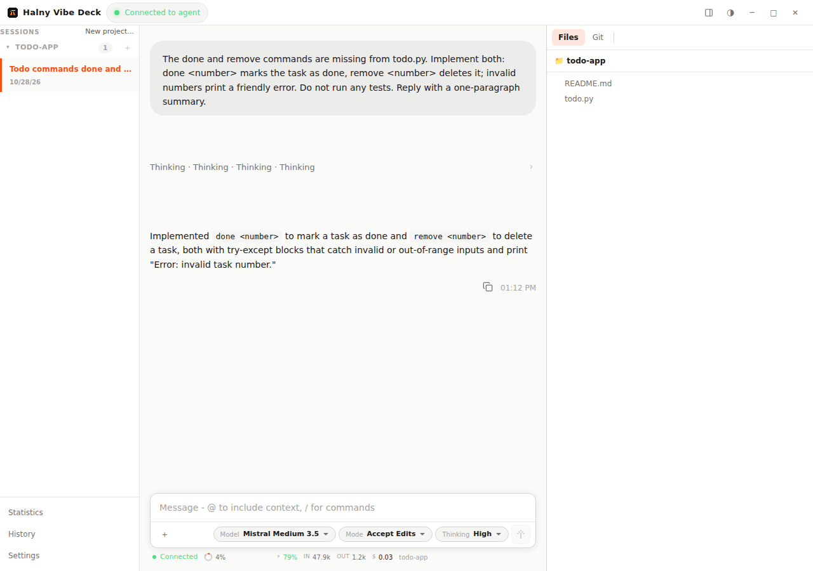
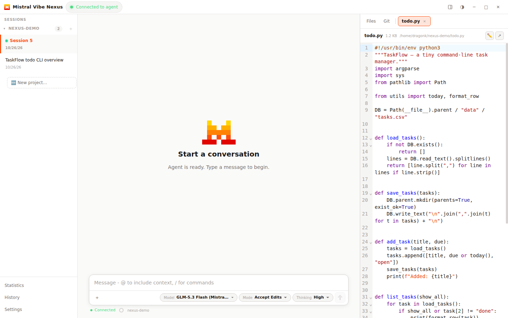
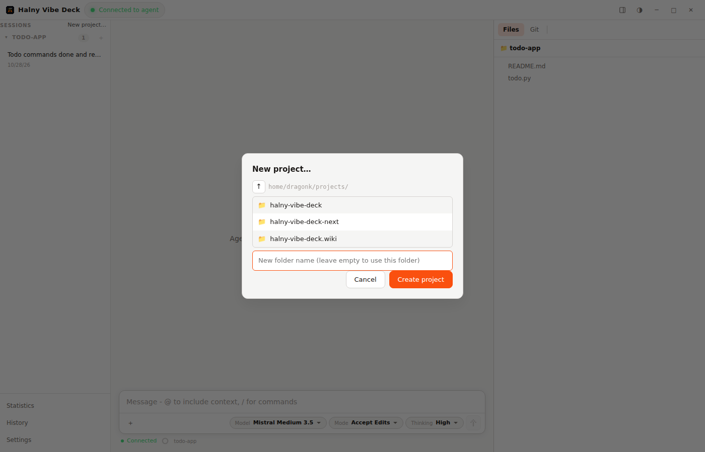
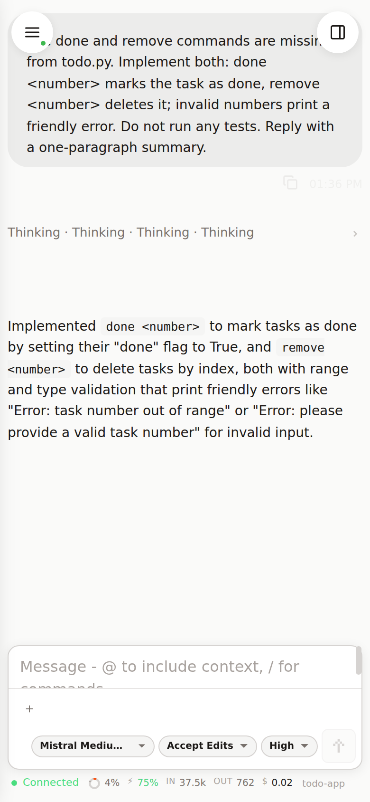

# Mistral Vibe Nexus

**A desktop and web client for the [Mistral Vibe](https://vibe.mistral.ai) AI coding agent** — built on Electron + React, talking to the `vibe-acp` CLI over ACP.



> **Unofficial project.** Mistral Vibe Nexus is built by an independent developer and is **not affiliated with, endorsed by, or supported by Mistral AI**. The author has no connection to Mistral — the project simply builds on top of Mistral Vibe and the Mistral Vibe CLI (`vibe-acp`). "Mistral" and "Mistral Vibe" are trademarks of Mistral AI.

Nexus wraps the agent in a full IDE-like workspace: resumable sessions, a file tree with live preview and editing, a git panel, usage/cost statistics, remote SSH projects, and a built-in HTTPS server so you can keep working from a browser or your phone.

| File preview with CodeMirror | New project (local & SSH) | Mobile / PWA |
| --- | --- | --- |
|  |  |  |

➡️ **The [project wiki](https://github.com/Dragonk/mistral-vibe-nexus/wiki) has detailed guides** for every feature.

## Features

### Chat & agent workflow
- **Streaming conversations** with the agent: thinking, tool calls, colored diffs and file links
- **Per-session model, mode and thinking level** — every session remembers its own configuration
- **Prompt queue** with send-now, retry, image attachments and `@file` mentions
- **Plans (todo checklists)** stay pinned in view while the agent works; restored on resume
- **Usage bar**: context %, cache hit ratio, tokens/s and live cost per session

### Sessions, history & statistics
- **Real session resume** with full history replay — also across app restarts
- **History tab**: search by title or full message content, time filters, hidden/restore
- **Statistics**: tokens (input/cached/output), cache hit ratio, cost per model and session

### Files, preview & editing
- **Dock panel**: file tree, git status/log/diff (stage, unstage, commit, push) and file preview tabs
- **Built-in editor (CodeMirror 6)** with syntax highlighting — click a file in chat or the tree, edit, hit `Ctrl+S`
- **Supported preview formats**: source/text files (≤ 4 MB), **images** (png, jpg, gif, webp, bmp, svg, ico, tiff), **PDF** (up to 20 pages), **spreadsheets** (xlsx/xls/csv with sheet tabs), **Word docx**, **Markdown** and **Mermaid diagrams**, **zip archives**, directories, and colored git diffs

### Remote SSH projects
- Add any number of SSH remotes — sessions, file tree, git and file editing all run **on the remote host**
- One worker per host handles multiple parallel sessions; remote sessions resume just like local ones

### Serve — browser & mobile access
- Built-in **HTTPS server** with login & password (scrypt-hashed, rate-limited)
- **PWA**: install on your phone, dark UI, drawer navigation, long-press menus
- Runs **headless** on a server — see the [Headless server guide](https://github.com/Dragonk/mistral-vibe-nexus/wiki/Headless-Server)

### Configuration
- Settings for **models, agents, MCP servers (static or OAuth), skills, prompts and tools**
- **Global and per-project scopes**, plus a raw TOML editor for the CLI config
- 6 languages: English, Polish, French, Spanish, German, Italian

## Quick start

### Windows

Download `Mistral-Vibe-Nexus-Setup-<version>.exe` (installer) or the portable zip from the [releases](https://github.com/Dragonk/mistral-vibe-nexus/releases) page.

### Linux

```bash
# User installation (no root), adds the 'vibe-nexus' command
curl -fsSL https://raw.githubusercontent.com/Dragonk/mistral-vibe-nexus/main/scripts/install-linux.sh | bash

# or use the AppImage:
chmod +x vibe-nexus-<version>-x64.AppImage
./vibe-nexus-<version>-x64.AppImage
```

Headless server (systemd autostart, login & password): see the **[wiki guide](https://github.com/Dragonk/mistral-vibe-nexus/wiki/Headless-Server)**.

### From source

```bash
git clone https://github.com/Dragonk/mistral-vibe-nexus.git
cd mistral-vibe-nexus
npm install
npm run build
npm start            # desktop
npx electron . --headless --serve --port=8443 --user=me --password=secret   # headless server
```

## Architecture

Three-process Electron application:
- **Main process**: window creation, IPC handlers, ACP manager, remote SSH transport, serve (HTTPS + WS), config & vibe-stats
- **Preload script**: typed IPC bridge exposed as `window.api`
- **Renderer process**: React UI (Vite) — shared by the desktop app and the web/PWA client

## Wiki

Detailed documentation lives in the [project wiki](https://github.com/Dragonk/mistral-vibe-nexus/wiki):

- [Installation](https://github.com/Dragonk/mistral-vibe-nexus/wiki/Installation) — Windows, Linux, from source
- [Headless Server](https://github.com/Dragonk/mistral-vibe-nexus/wiki/Headless-Server) — headless serve, login & password, systemd autostart, updates
- [File Preview & Editing](https://github.com/Dragonk/mistral-vibe-nexus/wiki/File-Preview-and-Editing) — supported formats, editor, attachments
- [Sessions & History](https://github.com/Dragonk/mistral-vibe-nexus/wiki/Sessions-and-History) — resume, replay, search, hidden items
- [Remote SSH Projects](https://github.com/Dragonk/mistral-vibe-nexus/wiki/Remote-SSH-Projects) — remotes, remote files & git
- [Web & Mobile (Serve/PWA)](https://github.com/Dragonk/mistral-vibe-nexus/wiki/Web-and-Mobile) — browser client, PWA, security
- [Settings & Configuration](https://github.com/Dragonk/mistral-vibe-nexus/wiki/Settings-and-Configuration) — models, agents, MCP, skills, scopes
- [Development](https://github.com/Dragonk/mistral-vibe-nexus/wiki/Development) — building, testing, releases

## Requirements

- Node.js 16+ (24 recommended) and npm
- Python 3.8+ and `uv` — the app auto-installs the `mistral-vibe` CLI on first run

## Development

```bash
npm run dev         # development mode with hot reload
npm run build       # build main, preload and renderer
npm run typecheck   # type-check all three tsconfigs
npm run dist        # distributable packages
```

## Testing

Tested primarily on Windows; Linux builds are provided and used for headless servers. If you hit an issue, please report it.

## Acknowledgments

Thanks to [@ahh1539 (Alex H)](https://github.com/ahh1539) for creating [Vibe Helper](https://github.com/ahh1539/vibe-helper) for macOS. The Statistics tab in Mistral Vibe Nexus was inspired by his application.

## License

Apache License 2.0 — see the [LICENSE](LICENSE) file for details.

## Contributing & Support

Contributions are welcome — open an issue or a pull request. If you find the project helpful, you can [support development](https://buymeacoffee.com/dragonk93).
