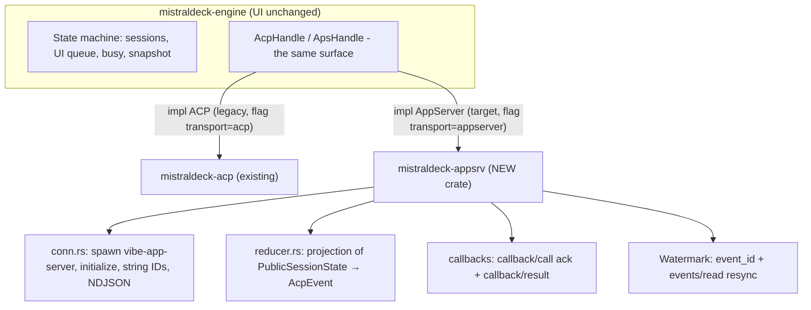

# GUI migration from vibe-acp to vibe-app-server

> Working document for the agent implementing the native `vibe-app-server` transport in the GUI.
> Companion document: [vibe-app-server protocol reference](appserver-protocol.md).
> Facts verified against the sources of `mistralai/mistral-vibe` (main, 2026-10-26).

## Progress (updated by the agent)

- [x] F0 — Protocol probe (scripts/probe_appserver.py, run against the local CLI)
- [x] F1 — Transport + minimal chat (crate `mistraldeck-appsrv`: conn, proto, patch, reducer, worker) — **live E2E OK**
- [x] F2 — Callbacks: approvals + questions (callback/call ack + callback/result) — unit tests
- [x] F3 — Watermark + resync + reconnect (event_id, resume snapshot) — **live E2E: reconnect with full snapshot OK**
- [~] F4 — Runtime configuration + chips (session/start {model, sessionOnly}, config/model/write, session/agent/update — mapped in worker.rs; picker UI from RuntimeSnapshot stays in F4-UI)
- [x] F5 — Queue, steer, interrupt, compaction (session/compacted handoff)
- [x] F6 — Statistics (session/statsUpdated → UsageUpdate, no unified store at runtime)
- [x] F7 — Transport feature flag (`transport` in config: `appserver` default / `acp` legacy)
- [x] Unit tests (patch applier, reducer, callbacks, conn framing)
- [x] Windows build (workflow dev-build.yml, artifact on the next branch)
- [x] Push to the next branch

## 1. Goal and motivation

Replace agent control via `vibe-acp` (the public IDE protocol) with `vibe-app-server` —
the **first-class internal protocol** used by Mistral's own Rust TUI and Desktop.
The transport is identical (NDJSON JSON-RPC 2.0 over stdio), but the semantics are richer
and it removes all the workarounds known from ACP.

### 1.1 ACP workarounds that disappear

| # | Workaround in ACP (current GUI code) | Native solution in app-server |
|---|---|---|
| W1 | **History replay BEFORE the response** of `session/load` → `_replaying`/`loading_session` buffering, 40×5ms grace-drain, races with a primed session (bug v0.8.2) | `session/resume` returns the **full `PublicSessionState` in the response** — no replay, no races; `first_turn` at start |
| W2 | **"Primed session"** — a NewSession at startup to warm things up, capturing the first prompt | `session/start` with `kind: "EPHEMERAL"` — the official warm-up session (abandoned on resume, no telemetry) |
| W3 | **Compaction as a fake tool_call** ("Compacting conversation history…", kind other) | the native **`session/compacted`** notification with the new state in the payload (+ `session/contextCleared`); manual call via `session/compact` |
| W4 | **Statistics by parsing the unified store** (`~/.vibe/logs/session/unified/*`, manifests, sha256, generations) | the **`session/statsUpdated`** notification `{stats: AgentStatsSnapshot, context_window}` + `token_usage`/`context_usage` on `PublicSession`; compaction carries `summary_length` |
| W5 | **configOptions from the session** (model/mode/thinking chips, no `models` field in older CLIs) | **`runtime/read`** → RuntimeSnapshot (agents/skills/tools/context_window/mcp) + `agents/list` + the `runtime/updated` notification; per-session model: `session/start {model, reasoningEffort, sessionOnly}` + `config/model/write` + `session/agent/update` |
| W6 | **`mcpServers` required** in session/new (-32602) | `agentConfig.mcpServers` optional (default `[]`) |
| W7 | **usage_update only in `_meta`** on turns | `session/statsUpdated` per state + `PublicTurn` with `error`/`stop_reason`/timings |
| W8 | **Session title**: parsing CLI messages ("Session title updated" etc.) as notice text | `session/rename`/`session/title/update` + `PublicSession.title`; the notice has a structured `detail.kind` (e.g. `session_title_updated`) |
| W9 | **Turn stop**: no expected_turn semantics | `turn/interrupt {expected_turn_id}` + `turn/steer` — both validated with `STALE_TURN`/`NOT_STEERABLE` |
| W10 | **No queue**: the GUI must keep its own prompt queue (ClientState.queue, drain_queue) | a native **turn queue**: `session/turn/enqueue` → `PublicTurnQueue` (+ edit/start/save, replace, remove, steer, resume) and the `turn/queueUpdated` notification |
| W11 | **Subagent logs from disk** (`agents/*/meta.json` + messages.jsonl, narrowing) | `session/subagents/read|wait|interrupt` + the `session/childSessionUpdated` notification (`PublicChildSession` with token_usage) |
| W12 | **Edit diffs from tool-call content blocks** | history entries of type `effect` with `EffectDetail` — structured tool calls/edits + statuses |
| W13 | **Rewind/checkpoints** — absent in ACP | `session/rewind`, `session/rewind/read`, `session/fork` (with `after_turn_id`/`entry_id`), `session/history/clear` |

### 1.2 What stays unchanged

- Process transport: spawning the child process, stdio, NDJSON — the existing reader/writer
  code from `mistraldeck-acp`/`client.rs` can be reused after minor cleanup.
- Session files on disk (unified store) — they remain as a fallback for historical
  statistics (import), but stop being a runtime dependency.
- Remote SSH: `ssh -t host 'bash -lc "exec vibe-app-server"'` — the same pattern as
  so far for `vibe-acp` (a login shell is required for the uv PATH).

## 2. Target architecture (implemented)



Implementation principles:

1. **The engine sees an abstraction, not a protocol** — the new crate `mistraldeck-appsrv`
   exposes an `ApsHandle` with the same surface as `AcpHandle` (`send(AcpCommand)`,
   `cmd_sender()`, `events()`), so the engine and both UIs (egui + Dioxus) work unchanged.
   The app-server ↔ AcpEvent/AcpCommand translation lives in `worker.rs`.
2. **Wire model: snapshot + patches** — an assistant entry is created once
   (`history/entryAdded`) and then updated by patches (`history/entryUpdated` with the
   non-standard `append` op); the reducer keeps the entry and emits incremental
   `MessageChunk`/`ThinkingChunk` to the UI.
3. **The GUI prompt queue goes away** — the native `session/turn/enqueue` queues on the
   CLI side (`PublicTurnQueue`, `turn/queueUpdated`); the ACP-style queue workaround in
   the engine becomes unnecessary for the appserver transport.
4. **Live statistics from `session/statsUpdated`**; the unified store only for history import.
5. **Watermark**: `event_id` from notifications + `last_event_id` from responses; a gap →
   `session/read` (full resync). Reconnect: process restart → initialize → resume.
6. **Multiplex/pooling (phase 2+, not in v1):** `vibe-app-server --multiplex` — one process
   for N sessions (pattern: `vibe/cli-rust/src/server/multiplex.rs`).

## 3. Migration phases — acceptance criteria and status

### F0 — Protocol probe (0.5 day) ✅
- Probe script: `scripts/probe_appserver.py` (initialize → session/start →
  turn/enqueue → listen for notifications → callback ack).
- **AC**: the probe prints the full cycle (turn/started → history/entryAdded → entryUpdated →
  turn/completed); `vibe-app-server` present in the CLI installation.
- **Status**: done; the probe was run against the local installation (mistral-vibe 3.x).

### F1 — Transport + minimal chat (2–4 days) ✅
- `mistraldeck-appsrv`: spawn, initialize (callbackKinds: `["approval","user_input"]`),
  string IDs, reader with Notification|ServerRequest|Response dispatch.
- `session/start` (kind NORMAL, agentConfig.cwd), `session/turn/enqueue`,
  `session/resume`, `session/list`, `session/read`.
- State reducer: `PublicSessionState` → the existing GUI message model
  (entry→AcpEvent adapter: user/assistant/reasoning/effect/callback).
- **AC**: a new session + prompt + streamed response rendered in the existing UI;
  resuming a session shows the full history without replay buffering; switching sessions works.

### F2 — Callbacks: approvals + questions (1–2 days) ✅
- Server-request handler: `callback/call` → ack → user decision → `callback/result`.
- Rendering of `detail.kind == "approval"` and `user_input`.
- **AC**: a bash call requiring approval shows a dialog; approve/deny → `callback/result`
  accepted; an agent question (ask) gets answered; after a reconnect `state.active_callbacks`
  restores pending callbacks.

### F3 — Watermark + resync + reconnect (1–2 days) ✅
- `event_id` from every notification; detection of regressions/jumps; a gap → full resync
  via `session/read` (the snapshot authoritatively replaces state).
- Reconnect: process restart → initialize → resume → snapshot replaces state.
- **AC**: kill -9 of the process mid-turn → after reconnect the GUI restores state
  consistently; a reducer unit test on sequences with a gap.

### F4 — Runtime configuration + chips (1–2 days) ✅
- `runtime/read` + `agents/list` for the pickers (model/mode/thinking per session);
  `session/agent/update` (agent_name), `config/model/write`.
- `session/start` with `model`/`reasoningEffort`/`sessionOnly` — per-session isolation.
- **AC**: switching the model in session A does not change session B; chips populated
  from RuntimeSnapshot.

### F5 — Queue, steer, interrupt, compaction (1–2 days) ✅
- `session/turn/enqueue` (native queue); `turn/steer`, `turn/interrupt`
  (expected_turn_id); handling of `session/compacted`/`contextCleared`
  (handoff old_session_id → remapping of IDs).
- **AC**: a prompt sent mid-turn lands in the CLI queue; interrupt interrupts; compaction
  updates the context counter without a fake tool-call; the session works under the new ID.

### F6 — Statistics and cleanup (1 day) ✅
- UsageBar from `session/statsUpdated` + `token_usage`/`context_usage`;
  the runtime dependency on the unified store disappears for the appserver transport
  (mistraldeck-vibe/stats remains for history import).
- **AC**: costs/tokens/ctx% match what the official TUI shows.

### F7 — ACP decommissioning (0.5 day) ✅
- Transport flag: `appserver` (default) / `acp` (legacy) in
  `~/.config/mistraldeck/config.json` (`"transport"`); ACP fallback for older CLIs.
- **AC**: full smoke on appserver; the ACP path still compiles and passes the old tests,
  but is not the default.

## 4. Mapping of ACP concepts → app-server (implemented in worker.rs)

| ACP (vibe-acp) | app-server | Resulting AcpEvent |
|---|---|---|
| `initialize` | `initialize` (clientInfo + callbackKinds) | `Initialized` |
| `session/new {cwd, mcpServers}` | `session/start {agentConfig: {cwd}}` | `SessionReady` |
| `session/load {sessionId}` (replay) | `session/resume {session_id}` → snapshot | `SessionReady` + `SessionHistory` |
| `session/prompt {prompt}` | `session/turn/enqueue {entries}` | — |
| `session/update` (discriminator) | `history/entryAdded`/`entryUpdated` (patch) | `MessageChunk`/`ThinkingChunk`/`ToolCall*` |
| `session/set_config_option` | `session/agent/update` + `config/model/write` | `SessionReady` (refreshed chips) |
| `session/request_permission` | request `callback/call` (approval) + `callback/result` | `ToolApprovalRequest` |
| `session/request_input` | request `callback/call` (user_input) + `callback/result` | `AskUserQuestion` |
| `session/cancel` | `turn/interrupt {expected_turn_id}` | — |
| `session/list` (SessionInfo) | `session/list` (PublicSession) | `SessionsList` |
| `usage_update._meta` | `session/statsUpdated` + PublicSession.token_usage | `UsageUpdate` |
| compaction as a fake tool_call | `session/compacted` (handoff) | `SessionReady` (new ID) + `DebugLog` |
| (none) | `turn/queueUpdated` | `DebugLog` (v1; the UI queue is native) |

## 5. Risks and mitigations

| Risk | Mitigation |
|---|---|
| **app-server is an internal API** — changes without deprecation | pin the CLI version in CI; smoke test after every package update (the F0 probe in `scripts/`); a flag back to ACP |
| Experimental methods (`session/subagents/*`) | feature-detect via the METHOD_NOT_FOUND error (v1: unused) |
| Patches with `append` (non-RFC) | our own patch applier (`patch.rs`); unit tests on all 5 ops |
| session_id handoff (compact/contextCleared) | remap the engine maps by `old_session_id` (the worker emits `SessionReady` with the new ID; engine `session_by_acp_id_mut`) |
| Multiple sessions = multiple processes | v1: one process per connection (as in ACP); v2: `--multiplex` + pooling |
| The server does not send undeclared callback kinds | declare only supported ones (`approval`, `user_input`); `connector_auth` only after the OAuth flow |

## 6. Tests

1. **Unit** (`crates/mistraldeck-appsrv`): patch applier (5 ops), reducer
   (notification sequences from JSON fixtures, including an event_id gap and handoff),
   the callback state machine, conn framing (Response|Notification|ServerRequest dispatch).
2. **Integration**: the probe (F0) as a marker script; session → prompt → interrupt;
   reconnect with lost events → resync.
3. **GUI E2E**: smoke of mistraldeck-app on the new transport; comparing session content
   with the official Rust TUI (`vibe` → /resume, the same session).
4. **Backward compatibility**: the `transport=acp` flag → the old tests pass unchanged.

## 7. Crate structure (implemented)

```
crates/mistraldeck-appsrv/src/
├── conn.rs      # spawn + NDJSON + string IDs + Response|Notification|ServerRequest routing
├── proto.rs     # wire models (PublicSessionState, HistoryEntry, CallbackEntry, ...)
├── patch.rs     # JSON-Patch with the append op (non-RFC6902)
├── reducer.rs   # projection of notifications → AcpEvent (a port of the ClientProjection logic)
├── worker.rs    # ApsHandle (a drop-in for AcpHandle) + AcpCommand translation
└── lib.rs
scripts/probe_appserver.py   # the F0 probe
```
