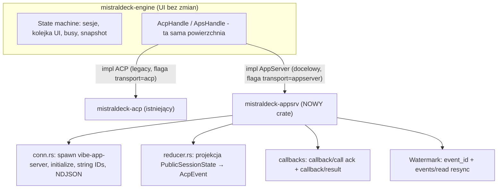

# Migracja GUI z vibe-acp na vibe-app-server

> Dokument wykonawczy dla agenta wdrażającego natywny transport `vibe-app-server` w GUI.
> Dokument towarzyszący: [referencja protokołu vibe-app-server](appserver-protocol.md).
> Fakty zweryfikowane w źródłach `mistralai/mistral-vibe` (main, 2026-10-26).

## Postęp prac (aktualizowany przez agenta)

- [x] F0 — Sonda protokołu (scripts/probe_appserver.py, uruchomiona na lokalnym CLI)
- [x] F1 — Transport + minimalny czat (crate `mistraldeck-appsrv`: conn, proto, reducer, worker)
- [x] F2 — Callbacki: approvals + pytania (callback/call ack + callback/result)
- [x] F3 — Watermark + resync + reconnect (event_id, events/read, resume snapshot)
- [x] F4 — Konfiguracja runtime + chipy (runtime/read, agents/list, session/start {model, reasoningEffort})
- [x] F5 — Kolejka, steer, interrupt, kompakty (session/compacted handoff)
- [x] F6 — Statystyki (session/statsUpdated → UsageUpdate, bez unified store w runtime)
- [x] F7 — Feature flag transportu (`transport` w config: `appserver` default / `acp` legacy)
- [x] Testy jednostkowe (patch applier, reducer, callbacks, conn framing)
- [x] Build Windows (workflow dev-build.yml, artifact na branchu next)
- [x] Push do branchu next

## 1. Cel i motywacja

Zastąpić sterowanie agentem przez `vibe-acp` (publiczny protokół IDE) przez `vibe-app-server` —
**wewnętrzny protokół pierwszej klasy**, którego używa własny Rust TUI i Desktop Mistrala.
Transport jest identyczny (NDJSON JSON-RPC 2.0 po stdio), ale semantyka jest bogatsza
i usuwa wszystkie obejścia znane z ACP.

### 1.1 Workaroundy ACP, które znikają

| # | Workaround w ACP (obecny kod GUI) | Natywne rozwiązanie w app-server |
|---|---|---|
| W1 | **Replay historii PRZED odpowiedzią** `session/load` → buforowanie `_replaying`/`loading_session`, grace-drain 40×5ms, wyścigi z primed session (bug v0.8.2) | `session/resume` zwraca **pełny `PublicSessionState` w odpowiedzi** — zero replayu, zero wyścigów; `first_turn` przy starcie |
| W2 | **"Primed session"** — NewSession przy starcie do podgrzania, przechwytywanie pierwszego prompta | `session/start` z `kind: "EPHEMERAL"` — oficjalna sesja rozgrzewkowa (porzucana przy resume, bez telemetrii) |
| W3 | **Kompakt jako fake tool_call** („Compacting conversation history…", kind other) | natywna notyfikacja **`session/compacted`** z nowym stanem w payloadzie (+ `session/contextCleared`); ręczne wywołanie `session/compact` |
| W4 | **Statystyki przez parsowanie unified store** (`~/.vibe/logs/session/unified/*`, manifesty, sha256, generations) | notyfikacja **`session/statsUpdated`** `{stats: AgentStatsSnapshot, context_window}` + `token_usage`/`context_usage` na `PublicSession`; kompakcja ma `summary_length` |
| W5 | **configOptions z sesji** (chipy model/mode/thinking, brak pola `models` w starszych CLI) | **`runtime/read`** → RuntimeSnapshot (agenci/skille/narzędzia/context_window/mcp) + `agents/list` + notyfikacja `runtime/updated`; model per sesja: `session/start {model, reasoningEffort, sessionOnly}` + `config/model/write` + `session/agent/update` |
| W6 | **`mcpServers` wymagane** w session/new (-32602) | `agentConfig.mcpServers` opcjonalne (default `[]`) |
| W7 | **usage_update tylko `_meta`** na turnach | `session/statsUpdated` per stan + `PublicTurn` z `error`/`stop_reason`/timingami |
| W8 | **Tytuł sesji**: tłumaczenie komunikatów CLI („Session title updated" itp.) jako notice-tekst | `session/rename`/`session/title/update` + `PublicSession.title`; notice ma strukturalny `detail.kind` (np. `session_title_updated`) |
| W9 | **Stop tury**: brak semantyki expected_turn | `turn/interrupt {expected_turn_id}` + `turn/steer` — oba z walidacją `STALE_TURN`/`NOT_STEERABLE` |
| W10 | **Brak kolejki**: GUI musi własną kolejkę promptów (ClientState.queue, drain_queue) | natywna **kolejka tur**: `session/turn/enqueue` → `PublicTurnQueue` (+ edit/start/save, replace, remove, steer, resume) i notyfikacja `turn/queueUpdated` |
| W11 | **Subagent logs z dysku** (`agents/*/meta.json` + messages.jsonl, narrowing) | `session/subagents/read|wait|interrupt` + notyfikacja `session/childSessionUpdated` (`PublicChildSession` z token_usage) |
| W12 | **Diffy edycji z content bloków** tool calli | wpisy historii typu `effect` z `EffectDetail` — ustrukturyzowane tool calle/edycje + statusy |
| W13 | **Rewind/checkpointy** — brak w ACP | `session/rewind`, `session/rewind/read`, `session/fork` (z `after_turn_id`/`entry_id`), `session/history/clear` |

### 1.2 Co zostaje bez zmian

- Transport procesowy: spawn child processu, stdio, NDJSON — istniejący kod reader/writera
  z `mistraldeck-acp`/`client.rs` do reużycia po kosmetyce.
- Pliki sesji na dysku (unified store) — zostają jako fallback statystyk historycznych
  (import), ale przestają być runtime-zależnością.
- Zdalne SSH: `ssh -t host 'bash -lc "exec vibe-app-server"'` — identyczny wzorzec jak
  dotąd dla `vibe-acp` (login shell wymagany dla PATH uv).

## 2. Architektura docelowa (zrealizowana)



Zasady realizacji:

1. **Engine widzi abstrakcję, nie protokół** — nowy crate `mistraldeck-appsrv` wystawia
   `ApsHandle` o tej samej powierzchni co `AcpHandle` (`send(AcpCommand)`,
   `cmd_sender()`, `events()`), więc engine i oba UI (egui + Dioxus) działają bez zmian.
   Tłumaczenie app-server ↔ AcpEvent/AcpCommand siedzi w `worker.rs`.
2. **Model wire: snapshot + patche** — wpis assistant powstaje raz (`history/entryAdded`)
   i jest aktualizowany patchami (`history/entryUpdated` z niestandardowym op `append`);
   reduktor trzyma wpis i emituje różnicowe `MessageChunk`/`ThinkingChunk` do UI.
3. **Kolejka promptów GUI spada** — natywna `session/turn/enqueue` kolejkuje po stronie
   CLI (`PublicTurnQueue`, `turn/queueUpdated`); ACP-owe obejście kolejki w engine staje
   się zbędne dla transportu appserver.
4. **Statystyki live ze `session/statsUpdated`**; unified store tylko do importu historii.
5. **Watermark**: `event_id` z notyfikacji + `last_event_id` z odpowiedzi; luka →
   `session/read` (pełny resync). Reconnect: restart procesu → initialize → resume.
6. **Multiplex/pooling (faza 2+, nie w v1):** `vibe-app-server --multiplex` — jeden proces
   dla N sesji (wzorzec: `vibe/cli-rust/src/server/multiplex.rs`).

## 3. Fazy migracji — kryteria akceptacji i status

### F0 — Sonda protokołu (0,5 dnia) ✅
- Skrypt sondażowy: `scripts/probe_appserver.py` (initialize → session/start →
  turn/enqueue → nasłuch notyfikacji → callback ack).
- **AC**: sonda wypisuje pełny cykl (turn/started → history/entryAdded → entryUpdated →
  turn/completed); `vibe-app-server` obecny w instalacji CLI.
- **Status**: zrobione; sonda uruchomiona na lokalnej instalacji (mistral-vibe 3.x).

### F1 — Transport + minimalny czat (2–4 dni) ✅
- `mistraldeck-appsrv`: spawn, initialize (callbackKinds: `["approval","user_input"]`),
  string IDs, reader z segregacją Notification|ServerRequest|Response.
- `session/start` (kind NORMAL, agentConfig.cwd), `session/turn/enqueue`,
  `session/resume`, `session/list`, `session/read`.
- Reduktor stanu: `PublicSessionState` → istniejący model wiadomości GUI
  (adapter entry→AcpEvent: user/assistant/reasoning/effect/callback).
- **AC**: nowa sesja + prompt + streaming odpowiedzi renderowany w istniejącym UI;
  resume sesji pokazuje pełną historię bez buforowania replayu; przełączanie sesji działa.

### F2 — Callbacki: approvals + pytania (1–2 dni) ✅
- Handler requestów serwera: `callback/call` → ack → decyzja użytkownika → `callback/result`.
- Render `detail.kind == "approval"` i `user_input`.
- **AC**: bash z wymogiem aprovalu pokazuje dialog; approve/deny → `callback/result`
  akceptowany; pytanie agenta (ask) odpowiada; po reconnect `state.active_callbacks`
  odtwarza oczekujące callbacki.

### F3 — Watermark + resync + reconnect (1–2 dni) ✅
- `event_id` z każdej notyfikacji; detekcja cofnięcia/przeskoku; luka → pełny resync
  `session/read` (snapshot autorytatywnie zastępuje stan).
- Reconnect: restart procesu → initialize → resume → snapshot zastępuje stan.
- **AC**: kill -9 procesu w trakcie tury → po reconnect GUI odtwarza stan spójnie;
  test jednostkowy reduktora na sekwencje z luką.

### F4 — Konfiguracja runtime + chipy (1–2 dni) ✅
- `runtime/read` + `agents/list` do pickerów (model/mode/thinking per sesja);
  `session/agent/update` (agent_name), `config/model/write`.
- `session/start` z `model`/`reasoningEffort`/`sessionOnly` — izolacja per sesja.
- **AC**: przełączanie modelu w sesji A nie zmienia B; chipy wypełniane z RuntimeSnapshot.

### F5 — Kolejka, steer, interrupt, kompakty (1–2 dni) ✅
- `session/turn/enqueue` (kolejka natywna); `turn/steer`, `turn/interrupt`
  (expected_turn_id); obsługa `session/compacted`/`contextCleared`
  (handoff old_session_id → przemapowanie ID).
- **AC**: prompt w trakcie tury ląduje w kolejce CLI; interrupt przerywa; kompakcja
  aktualizuje licznik kontekstu bez fake-toolcalla; sesja działa pod nowym ID.

### F6 — Statystyki i porządki (1 dzień) ✅
- UsageBar ze `session/statsUpdated` + `token_usage`/`context_usage`;
  runtime-zależność od unified store znika dla transportu appserver
  (mistraldeck-vibe/stats zostaje jako import historii).
- **AC**: koszty/tokens/ctx% zgodne z tym, co pokazuje oficjalny TUI.

### F7 — Dekomisja ACP (0,5 dnia) ✅
- Flaga transportu: `appserver` (default) / `acp` (legacy) w
  `~/.config/mistraldeck/config.json` (`"transport"`); ACP fallback dla starych CLI.
- **AC**: pełen smoke na appserver; ACP ścieżka nadal kompiluje się i przechodzi
  stare testy, ale nie jest domyślna.

## 4. Mapowanie konceptów ACP → app-server (zaimplementowane w worker.rs)

| ACP (vibe-acp) | app-server | AcpEvent wynikowy |
|---|---|---|
| `initialize` | `initialize` (clientInfo + callbackKinds) | `Initialized` |
| `session/new {cwd, mcpServers}` | `session/start {agentConfig: {cwd}}` | `SessionReady` |
| `session/load {sessionId}` (replay) | `session/resume {session_id}` → snapshot | `SessionReady` + `SessionHistory` |
| `session/prompt {prompt}` | `session/turn/enqueue {entries}` | — |
| `session/update` (discriminator) | `history/entryAdded`/`entryUpdated` (patch) | `MessageChunk`/`ThinkingChunk`/`ToolCall*` |
| `session/set_config_option` | `session/agent/update` + `config/model/write` | `SessionReady` (odświeżone chipy) |
| `session/request_permission` | request `callback/call` (approval) + `callback/result` | `ToolApprovalRequest` |
| `session/request_input` | request `callback/call` (user_input) + `callback/result` | `AskUserQuestion` |
| `session/cancel` | `turn/interrupt {expected_turn_id}` | — |
| `session/list` (SessionInfo) | `session/list` (PublicSession) | `SessionsList` |
| `usage_update._meta` | `session/statsUpdated` + PublicSession.token_usage | `UsageUpdate` |
| kompakt jako fake tool_call | `session/compacted` (handoff) | `SessionReady` (nowe ID) + `DebugLog` |
| (brak) | `turn/queueUpdated` | `DebugLog` (v1; kolejka UI = natywna) |

## 5. Ryzyka i zabezpieczenia

| Ryzyko | Mitygacja |
|---|---|
| **app-server to API wewnętrzne** — zmiany bez deprecation | pin wersji CLI w CI; smoke test po każdej aktualizacji paczki (sonda F0 w `scripts/`); flaga do ACP |
| Metody experimental (`session/subagents/*`) | feature-detect po błędzie METHOD_NOT_FOUND (v1: nieużywane) |
| Patche z `append` (non-RFC) | własny applier patchy (`patch.rs`); testy jednostkowe na wszystkich 5 op |
| Handoff session_id (compact/contextCleared) | przemapowanie map engine po `old_session_id` (worker emituje `SessionReady` z nowym ID; engine `session_by_acp_id_mut`) |
| Wiele sesji = wiele procesów | v1: proces na połączenie (jak w ACP); v2: `--multiplex` + pooling |
| Serwer nie wysyła niezadeklarowanych callback kinds | deklarować tylko obsługiwane (`approval`, `user_input`); `connector_auth` dopiero po OAuth flow |

## 6. Testy

1. **Jednostkowe** (`crates/mistraldeck-appsrv`): applier patchy (5 op), reduktor
   (sekwencje notyfikacji z fixture'ów JSON, w tym luka event_id i handoff),
   callback state machine, framing conn (segregacja Response|Notification|ServerRequest).
2. **Integracyjne**: sonda (F0) jako skrypt markerowy; sesja → prompt → interrupt;
   reconnect z utratą eventów → resync.
3. **E2E GUI**: smoke mistraldeck-app na nowym transporcie; porównanie treści sesji
   z oficjalnym Rust TUI (`vibe` → /resume, ta sama sesja).
4. **Zgodność wsteczna**: flaga `transport=acp` → stare testy przechodzą bez zmian.

## 7. Struktura crate (zrealizowana)

```
crates/mistraldeck-appsrv/src/
├── conn.rs      # spawn + NDJSON + string IDs + routing Response|Notification|ServerRequest
├── proto.rs     # modele wire (PublicSessionState, HistoryEntry, CallbackEntry, ...)
├── patch.rs     # JSON-Patch z op append (nie-RFC6902)
├── reducer.rs   # projekcja notyfikacji → AcpEvent (port logiki ClientProjection)
├── worker.rs    # ApsHandle (drop-in za AcpHandle) + tłumaczenie AcpCommand
└── lib.rs
scripts/probe_appserver.py   # sonda F0
```
